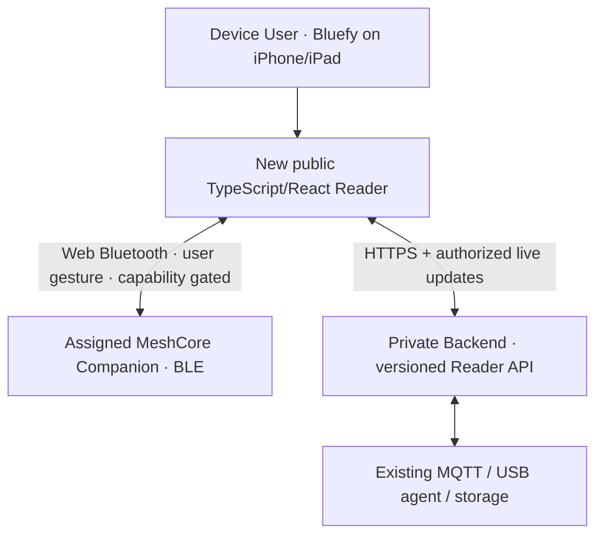

# MVP1 architecture — Bluefy Reader + existing private Backend

**Status:** Target integration design; interfaces require inventory and conformance. No new Backend implementation or migration in MVP1.

## Responsibilities

**Reader:** presentation, device/transport state, user interactions, local BLE adapter, identity selection and normalized message display. No direct MQTT credentials, private Backend internals, fleet-management bypass or Backend business logic.

**Companion:** canonical device identity and native MeshCore BLE operations; BLE may provide local messages and sends where supported. No assumption that browser can export keys or perform all stock-app operations.

**Private Backend:** existing session/auth, assigned-device authorization, authorized message history, online send, contacts/channels and outcome evidence, MQTT and USB-agent integration. Provide a **versioned, bounded compatibility API**. Preserve current Reader and existing production behavior.

## Critical integration rule

There are **two possible send/read paths** (direct BLE and online Backend). MVP1 must define an explicit active path, source provenance, stable message/attempt IDs and outcome mapping. **Never silently transmit the same draft through both paths** or merge local device messages into the wrong account. If safe dedup/reconciliation is unavailable, keep paths separate and show that limitation; do not imply full cross-source history or automatic failover.

## Browser support

**Primary:** Bluefy on iOS/iPadOS with Web Bluetooth, subject to real-device proof and device GATT compatibility. **Secondary:** desktop Chromium Web Bluetooth where supported. **Fallback:** Backend-only Reader in browsers without compatible BLE. Standard iOS Safari is not a promised BLE path. BLE access is permission- and foreground-sensitive; background behavior must be verified, not assumed.

## MVP1 API inventory

- Session, account and capability scope
- Assigned Companion list and authorized identities
- Conversations/messages with paging and provenance
- Channels/contacts/favourites with actual access rules
- Authorized send request and normalized outcomes
- Device status and transport/reachability evidence
- Live update subscription/reconnect where supported

Do not publish private production URLs, credentials, customer data or internal source code in this public repository. Build sanitized fixtures and contract tests.

## Deferred

Offline encrypted history and local unlock, automatic BLE/Backend event reconciliation, fleet-owner/admin GUI, observation analytics, public Backend implementation, OTA and firmware protocol expansion.

[Product vision](PRODUCT_VISION.md) · [UX](READER_UX.md) · [MVP plan](MVP1_PLAN.md)
