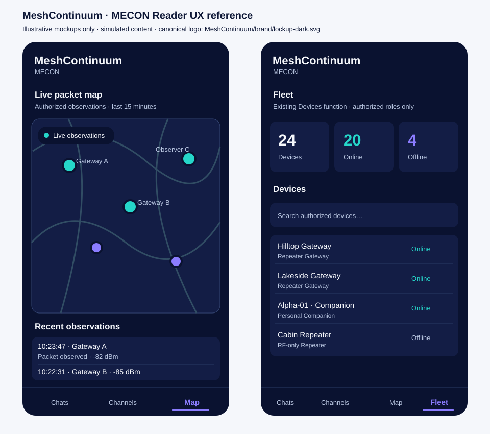

# Reader MVP1 — visual UX examples

> **Approved MVP1 implementation baseline (17 November 2026):** [MVP1 implementation design](MVP1_IMPLEMENTATION_DESIGN.md) governs milestone order, navigation, privacy, map, F2 deployment and acceptance. Older illustrative or five-tab descriptions are superseded where conflicting. Real hardware and Backend API conformance still require verification.

**Status:** illustrative reference mockups, **not** implemented UI or an approved pixel-perfect design. Data, device names and counts are fictitious. These mockups illustrate the owner's approved navigation and live packet observation starting point. The separate desktop/tablet Admin GUI remains deferred.

## MC1 screen references and MECON branded concept

Primary visual inspiration is [MeshCore One's App Store listing and screenshots](https://apps.apple.com/app/meshcore-one/id6757419477) and its [feature overview](https://github.com/Avi0n/MeshCoreOne). A separate newly generated MECON-branded multi-screen concept was presented in the project conversation on 17 November 2026. It shows Chats, Channels, observation Map, desktop split-view and authorized Fleet navigation; it is **illustrative only** and not checked into this repository. Do not infer implementation, real telemetry, approved locations or verified device capabilities from illustrative screenshots. The normative design, real brand SVGs and privacy restrictions override mockups. Web Reader stays React/TypeScript under Apache-2.0; do not copy GPLv3 MC1 app source or protected assets.

## Design constraints for the coder

- **Brand authority:** [MeshContinuum brand specification](https://github.com/hoejriis/MeshContinuum/blob/main/docs/BRAND.md). Use **actual** original SVGs from [MeshContinuum/brand](https://github.com/hoejriis/MeshContinuum/tree/main/brand), especially `lockup-dark.svg` / `lockup-light.svg`. The SVG concept above intentionally uses text in place of a logo; do **not** approximate or redraw the mark from it.
- Colours: navy `#0D1736`, turquoise `#25D6C9`, violet `#8B7CFF`, light `#F5F7FB`; dark surfaces `#0A1230` and `#131D45`. Respect documented contrast requirements.
- **All viewports:** persistent bottom **Chats / Channels / Map**. Phone Fleet Owner/Instance Admin with actual management capability gets **Fleet** as fourth bottom item, corresponding to today's Devices functionality. Ordinary users see three tabs. Contacts, Companion and Settings are secondary.
- **Map starts with live packet observations**, using authorized observation sources and public/role-scoped projections as appropriate. Show reception **at actual observer locations** and truthful RF metadata. Never infer transmitter location or draw a packet route from hearing alone. Respect privacy and observation-source publication rules; show empty/unavailable states.
- **Fleet:** the phone-oriented management entry reuses authorized existing Devices functions. It must not grant access to other users' private content. The larger desktop/tablet Admin GUI is a later separate design.
- This mockup is **not** evidence that Bluefy, packet map, RF metrics, fleet device counts or live APIs have been implemented.

## Tracking

- [Reader UX issue #3](https://github.com/hoejriis/mecon-backend/issues/3)
- [Reader shell issue #4](https://github.com/hoejriis/mecon-backend/issues/4)
- [Live observation API contract](LIVE_OBSERVATION_API_CONTRACT.md)
- [Architecture Decision Register](ARCHITECTURE_DECISIONS.md)

**Source of truth:** normative documents and approved GitHub issues override any illustrative screen details.
