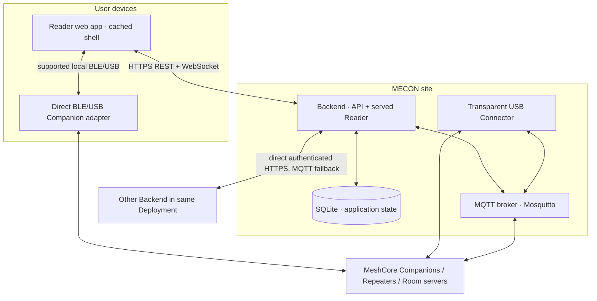

# Target architecture — public MECON application

**Target specification, not current implementation.** MVP1 is only the Device User Reader GUI. No issues should be opened for the later architecture until MVP1 is complete or the product owner changes priority.

## Design goals

An approachable, self-hostable MeshCore companion service for **individuals and small communities equally**. Preserve independent MeshCore RF operation, allow an ordinary one-site Raspberry Pi deployment, and grow into multi-site/federated deployments without making a cloud operator mandatory. The public Backend and Reader form one application deployment, with a separate MQTT broker and optional transparent USB Connector.

## Components and boundaries

1. **Backend + Reader:** one deployed application. Backend is a Python/FastAPI modular monolith, SQLite application database, versioned HTTPS REST/WebSocket APIs, account/session/authorization, messages/observations/history, device orchestration, and federation. Reader is a TypeScript/React client served by Backend. An offline-capable shell is possible later; the Reader is not a separately hosted server.
2. **MQTT broker:** standard Mosquitto with transparent transport and topic ACLs; no message decryption, user roles, device identity substitution or business logic. Devices use one active broker profile; Backends may attach to several brokers.
3. **USB Connector:** transparent serial-to-MQTT transport for local attached devices, not an identity authority, packet inspector or route planner. Direct browser BLE/USB is a separate Reader-device adapter.
4. **Firmware:** native MeshCore continues working without MECON. The independent [mecon-firmware](https://github.com/hoejriis/mecon-firmware) project defines optional managed-device capabilities, not a requirement to use MECON messaging.

## Identity and trust

Companion remains canonical custodian of its MeshCore private key. A separately authorized Backend may hold an explicitly delegated copy for online messaging. Reader does not persist private keys. Device signing authority is separate from MQTT credentials. A Deployment has a long-lived authority and Backends have distinct instance identities; broker reachability is not administrative authority.

## Messaging, observations and authorization

The Backend deduplicates packets while preserving independent reception evidence and provenance. Raw observations never confer message decryption rights. Device Users read messages addressed to public channels or their authorized identities/private channels; they do not receive a fleet packet-explorer entitlement. Fleet Owner and Instance Admin authority cannot bypass another user's private-message access. See [roles](ROLES_AND_PERMISSIONS.md), [User](USER_EXPERIENCE.md), [Fleet Owner](FLEET_OWNER_EXPERIENCE.md), [Admin](ADMIN_EXPERIENCE.md).

## Continuity, offline and federation

Backends in one Deployment can join via existing authorized continuity material, mutual instance authentication and approval; a separate cold-recovery path exists if no trusted Backend survives. Federation exchanges versioned application events and snapshots, not blindly mirrored SQLite files or executable jobs. Direct HTTPS first, MQTT fallback. Reader's later offline cache contains selected authorized data, encrypted and locally unlocked where supported; no full Backend replica. Unique unsent drafts must not be silently deleted or retransmitted on reconnect.

## Deployment shape

A single Raspberry Pi can host Backend+Reader, Mosquitto and USB Connector; components can instead be distributed. One administrator/trust domain can have several Backends, multiple fleets and users. See [deployments](DEPLOYMENTS.md), [component contracts](COMPONENTS.md), [privacy](SECURITY_AND_PRIVACY.md) and [roadmap](ROADMAP.md).

## MVP1 exception

The **first implementation** is a new Bluefy-focused Device User Reader. It uses direct BLE where proven and a versioned API on the **existing MECON Backend**, which continues to run MQTT, USB Connector, account and online messaging services. The new public Backend, fleet/admin screens, federation, advanced offline support and deployment packaging are **target-only**. See [MVP1 architecture](MVP1_ARCHITECTURE.md).
